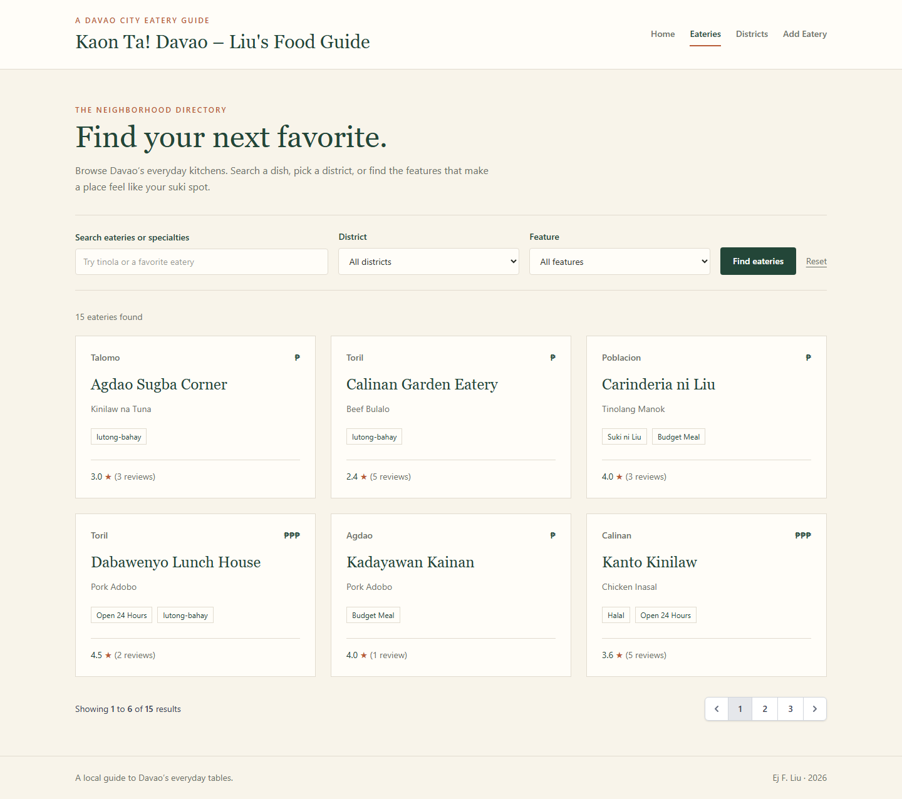
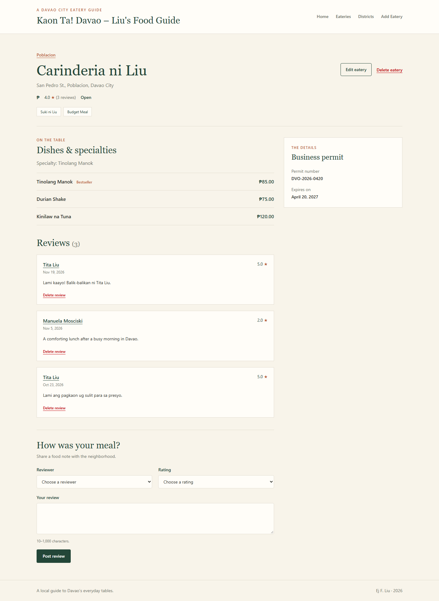
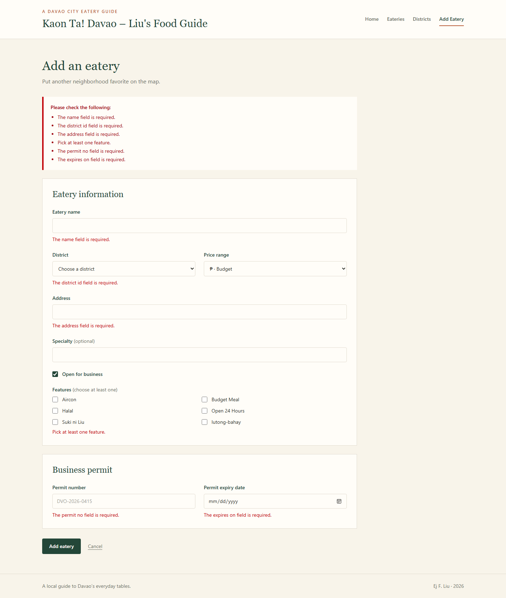

# Kaon Ta! Davao — Liu's Food Guide

**Author:** Ej F. Liu

A public carinderia and eatery guide for Davao City, built for the CS Elective 2 Prefinal Milestone Project. Browse eateries by district, specialty, and feature; read dishes, permits, and reviews; and manage eatery listings and community reviews.

## Technology

Laravel 12, SQLite, Blade, Tailwind CSS v4, Vite, Eloquent ORM, migrations, factories, seeders, and Form Requests. The interface uses a small vanilla JavaScript handler for delete confirmations. There is no authentication or registration: seeded users are selected as reviewers.

Verified with PHP 8.5.0, Composer 2.8.12, Node.js 24.22.1, and npm 11.19.1. Use PHP 8.4 or newer with PDO SQLite enabled for the committed dependency lockfile, and Node.js 20.19+ or 22.12+ for Vite.

## Setup

Clone this repository and run the handout's commands from the project directory:

```bash
composer install
cp .env.example .env
php artisan key:generate
touch database/database.sqlite
php artisan migrate:fresh --seed
npm install
npm run build
php artisan serve
```

Open <http://127.0.0.1:8000>. The fresh migration command clears the database before seeding it.

During development, run `npm run dev` in another terminal instead of using the production build. On Windows PowerShell, use `Copy-Item .env.example .env` for `cp`, `New-Item database/database.sqlite -ItemType File` for `touch`, and `npm.cmd` if PowerShell blocks `npm.ps1`.

SQLite is the default connection; the `.env.example` needs no database-server credentials. Application dates use `Asia/Manila`.

## Personalized seed data

| Item | Values |
|---|---|
| Districts | Poblacion, Talomo, Agdao, Buhangin, Toril, Calinan |
| Features | Suki ni Liu, Budget Meal, Halal, Open 24 Hours, Aircon, lutong-bahay |
| User 1 | Ej Liu — `liu@kaonta.test` |
| User 2 | Tita Liu — `tita.liu@kaonta.test` |
| Both personalized passwords | `kaonta2026`, stored as hashes |
| Eatery | Carinderia ni Liu |
| Slug | `carinderia-ni-liu` |
| District / address | Poblacion / San Pedro St., Poblacion, Davao City |
| Price / specialty / status | budget / Tinolang Manok / open |
| Features on the personal eatery | Suki ni Liu and Budget Meal |
| Permit | `DVO-2026-0420`, expires `2027-04-20` |

The personalized eatery has exactly these dishes:

| Dish | Price | Bestseller |
|---|---:|---|
| Tinolang Manok | ₱85.00 | Yes |
| Kinilaw na Tuna | ₱120.00 | No |
| Durian Shake | ₱75.00 | No |

It has three seeded reviews, including Tita Liu's five-star review: **Lami kaayo! Balik-balikan ni Tita Liu.**

A fresh seed creates exactly **6 districts, 6 features, 12 users, 15 eateries, 3 closed eateries, and 15 permits**. The other 14 eateries come from `EateryFactory`, with three using `closed()`. Each has 2–5 dishes and 1–3 distinct features. Open factory eateries receive 0–6 reviews from existing users; closed eateries receive none. At least one permit is expired and at least three eateries have reviews. Names, ratings, and the total review count vary between fresh seeds.

## Relationships


| Relationship method | Type | Why it fits |
|---|---|---|
| `District::eateries()` → Eatery | hasMany | A district can contain several eateries. |
| `Eatery::district()` → District | belongsTo | Each eatery is located in one district. |
| `Eatery::dishes()` → Dish | hasMany | One eatery can list several dishes. |
| `Dish::eatery()` → Eatery | belongsTo | Each dish belongs to the eatery that serves it. |
| `Eatery::reviews()` → Review | hasMany | An eatery can receive reviews from several residents. |
| `Review::eatery()` → Eatery | belongsTo | Each review describes one eatery. |
| `User::reviews()` → Review | hasMany | One reviewer can write several reviews. |
| `Review::user()` → User | belongsTo | Each review records the user who wrote it. |
| `Eatery::permit()` → Permit | hasOne | Each eatery has one business permit; the unique foreign key enforces this. |
| `Permit::eatery()` → Eatery | belongsTo | A permit is issued to one eatery. |
| `Eatery::features()` → Feature | belongsToMany | One eatery can have several features, and a feature can describe several eateries. |
| `Feature::eateries()` → Eatery | belongsToMany | A feature such as Budget Meal can be shared by many eateries. |
| `District::reviews()` → Review through Eatery | hasManyThrough | A district gathers the reviews attached to its eateries without storing a district ID on reviews. |

The `eatery_feature` pivot stores each eatery/feature pair once using a composite primary key. `attach()` adds pairs, `sync()` replaces the selected pairs, and `detach()` removes pairs without deleting features.

## Routes

Actual output of `php artisan route:list --except-vendor`:

```text

  GET|HEAD        / ............................................................................ home › HomeController
  GET|HEAD        districts ............................................... districts.index › DistrictController@index
  GET|HEAD        districts/{district} ...................................... districts.show › DistrictController@show
  GET|HEAD        eateries ................................................... eateries.index › EateryController@index
  POST            eateries ................................................... eateries.store › EateryController@store
  GET|HEAD        eateries/create .......................................... eateries.create › EateryController@create
  GET|HEAD        eateries/{eatery} ............................................ eateries.show › EateryController@show
  PUT|PATCH       eateries/{eatery} ........................................ eateries.update › EateryController@update
  DELETE          eateries/{eatery} ...................................... eateries.destroy › EateryController@destroy
  GET|HEAD        eateries/{eatery}/edit ....................................... eateries.edit › EateryController@edit
  POST            eateries/{eatery}/reviews .......................... eateries.reviews.store › ReviewController@store
  GET|HEAD        reviewers/{user} .......................................... reviewers.show › ReviewerController@show
  DELETE          reviews/{review} ........................................ reviews.destroy › ReviewController@destroy

                                                                                                   Showing [13] routes
```

Eatery routes bind by slug, including review submissions; district, reviewer, and review routes bind by ID. Unknown eatery slugs return 404.

## Validation and behavior

The three Form Requests keep validation out of controllers. The shared create/edit partial displays an error summary, field errors, and old input. Hidden checkbox values allow an unchecked Open field to save false; unchecked features remain unchecked after validation fails.

Names are converted with `Str::slug()`. Names producing a duplicate URL, an empty slug, or the reserved slug `create` are rejected with a name error. Updates ignore the bound eatery and its own permit for uniqueness checks.

Permit dates must be **after today** on create/update, as required by the handout. An expired permit therefore needs a future expiry date before its eatery can be saved. The detail page labels a permit expired only when its date is **before today**.

Review authorization returns 403 for closed eateries, including crafted POST requests. Controllers eager-load displayed relationships and calculate review counts/averages before rendering. Eatery creation, updates, and deletion use transactions. Deletion explicitly removes the permit, dishes, reviews, and pivot pairs through relationships before deleting the eatery; districts, users, and features are preserved.

## Screenshots

These are actual captures of the running application. Random seed values may differ on a fresh install.

### Eatery directory



### Eatery details with reviews



### Create form with validation errors



## Verification

```bash
php artisan test
php artisan route:list --except-vendor
npm run build
```

The automated suite covers schema constraints, model relationships and casts, exact seeding, ranking and filters, pagination, slug binding, form validation, CRUD, review authorization, deletion cleanup, and eager-loaded views. Tests use an isolated in-memory SQLite database.

A separate local clone of commit `b9b1a16` was installed using the prescribed setup commands on November 19, 2026. Dependency installation, key generation, fresh migration/seeding, production build, and all eight page types checked succeeded without application fixes. Browser checks confirmed the directory's 1/2/3-column layout at 375/768/1440 pixels and no horizontal overflow.

See [the rubric audit](docs/rubric-audit.md) for evidence and remaining author/submission checks. The professor's live defense assessment remains separate from automated test results.

For the live demo, see [the defense notes](docs/defense-notes.md).
